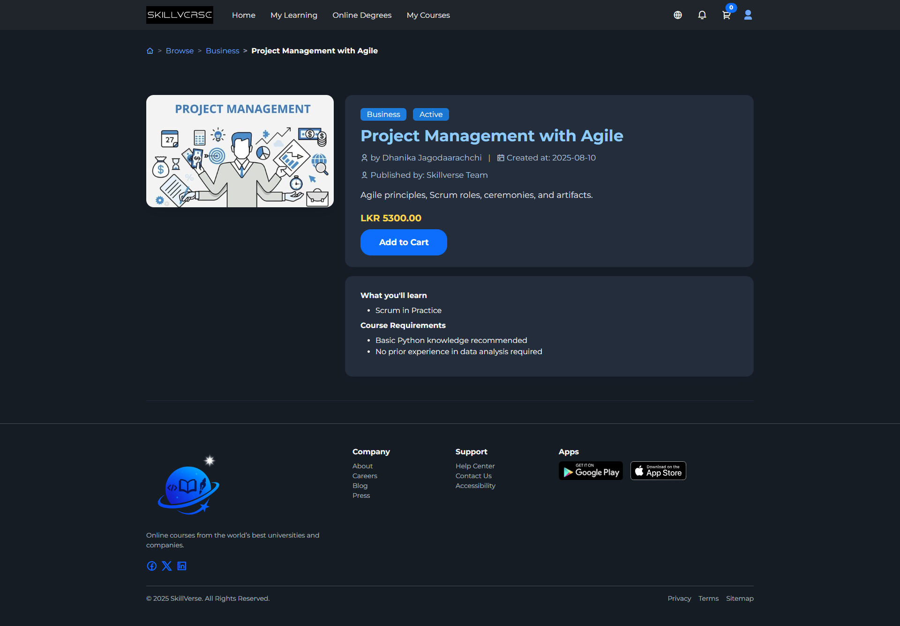
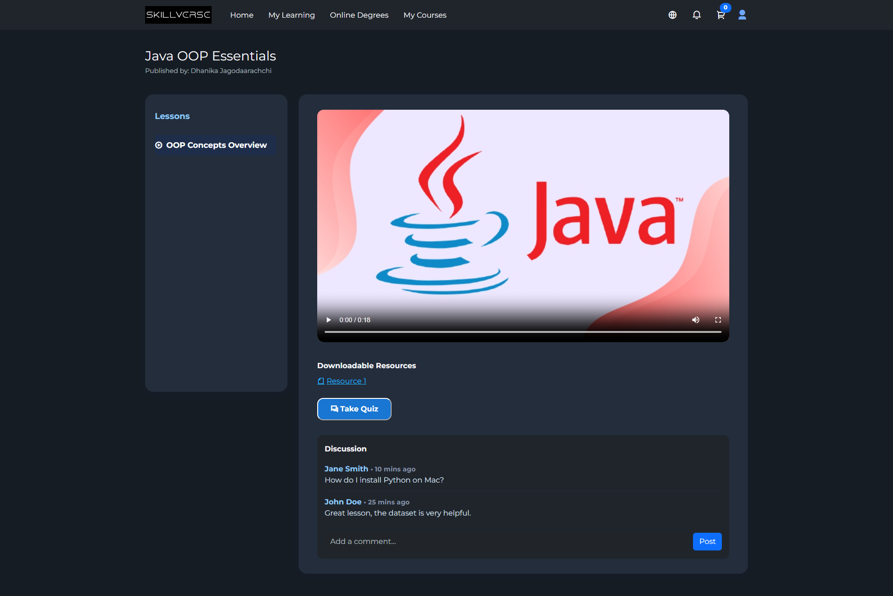
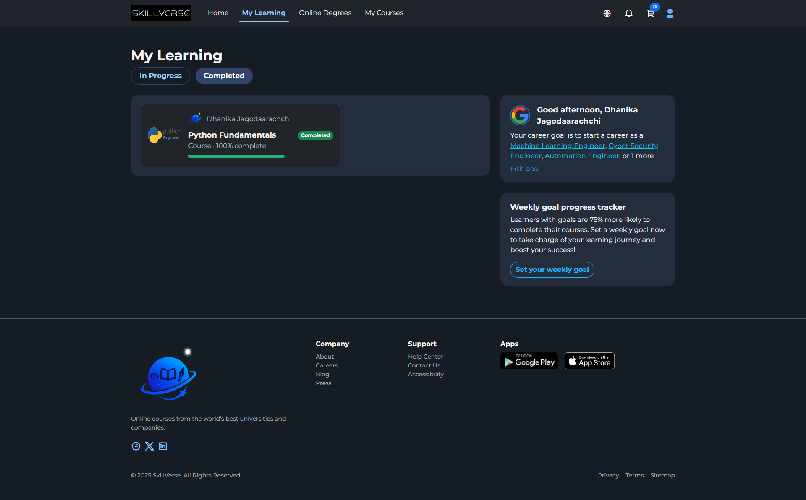
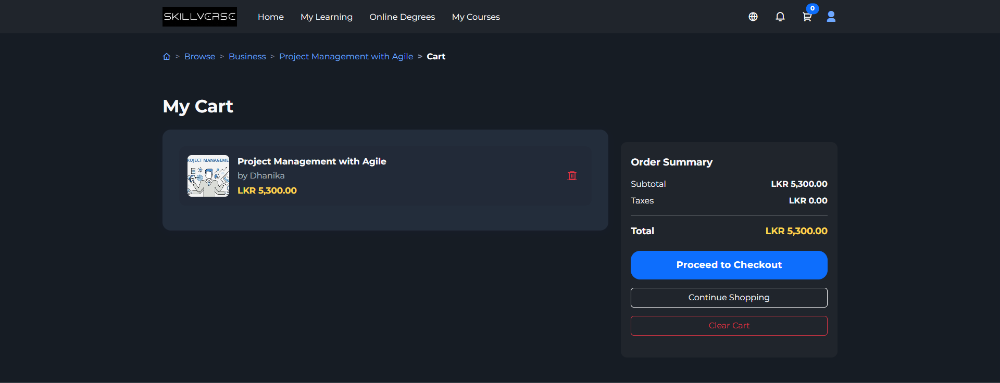
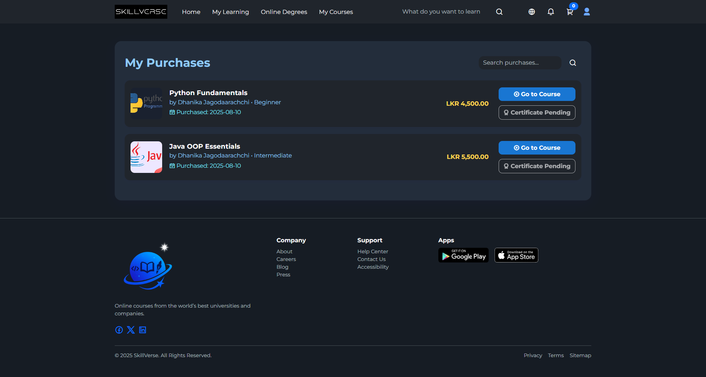
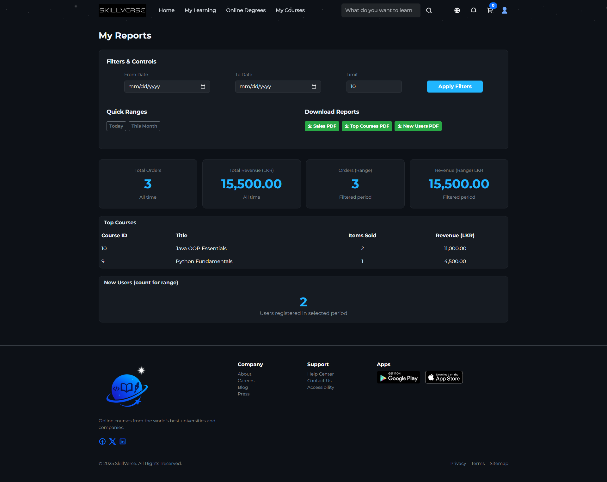

# SkillVerse

<p align="center">
  
</p>

**SkillVerse** is an online learning marketplace built with Java servlets, Hibernate and MySQL. Learners browse courses, add them to a cart, pay through the PayHere sandbox and study from their *My Learning* area. Any signed-in user can also publish a course with video lessons, downloadable resources and a quiz. An admin-style reports page offers sales, top-course and new-user reports with PDF export.

> **Status:** academic / portfolio project, runs locally on GlassFish. Payments use the **PayHere sandbox** only. See [Known limitations](#known-limitations) before deploying anywhere public.

## Live demo

A static build of the real front end with simulated backend responses and fictional test data can be hosted on Vercel. It comes with ready-made logins (learner and instructor) and a sandbox checkout. See [`demo/README.md`](demo/README.md) for the logins, how it works and how to deploy it.

## Table of Contents

- [Features](#features)
- [Screenshots](#screenshots)
- [Technology Stack](#technology-stack)
- [Architecture](#architecture)
- [Project Structure](#project-structure)
- [Data Model](#data-model)
- [Getting Started](#getting-started)
- [Configuration](#configuration)
- [Usage Walkthrough](#usage-walkthrough)
- [Known Limitations](#known-limitations)
- [Roadmap](#roadmap)
- [Contributing](#contributing)
- [License](#license)
- [Author](#author)

## Features

### Learners
- Public landing page and course catalogue with category filter and search
- Course detail page with lesson outline
- Sign up with **email verification code**, sign in, optional "remember me"
- Shopping cart (guests and signed-in users), cart drawer with live item count
- Checkout through **PayHere** (sandbox, LKR) with server-side order total and signed payment-notification verification
- **My Learning** with in-progress / completed tabs, **lesson player** (video + downloadable resources)
- Purchase history and profile page (photo, city, gender)

### Instructors
- Create a course: title, description, category, difficulty, price (free / paid), thumbnail
- Add ordered lessons, each with a video and a resource file (uploaded to **Cloudinary** from the browser)
- Author a quiz (multiple choice, four options) per course
- *My Courses* list of published courses

### Reports
- Summary, top courses and new-user reports over a date range
- PDF export of each report (iText)

> There is no role system yet: every signed-in user can reach the instructor and reports pages. See [Known limitations](#known-limitations).

## Screenshots

| | |
|---|---|
|  **Landing page** |  **Home** |
|  **Course details** |  **Lesson view** |
|  **My Learning** |  **Cart** |
|  **Purchase history** |  **Reports** |

## Technology Stack

| Layer | Technology |
|---|---|
| Language / runtime | Java (project source level 1.7; the code also calls `URLEncoder.encode(String, Charset)`, so it needs **JDK 10+** to compile) |
| Web layer | Java Servlet 3 (annotation-mapped), servlet filters; **no JSP** - HTML pages call JSON endpoints with `fetch()` |
| Persistence | **Hibernate 4.3.1** (annotation mapping, Criteria API) on **MySQL**, driver `mysql-connector-j 8.4.0` |
| Front end | HTML5, JavaScript (vanilla), **Bootstrap 5.3.3** (CDN), Remix Icon, Chart.js, GSAP |
| JSON | Gson 2.10.1 |
| PDF | iText 5.5.13.2 |
| Email | JavaMail over Gmail SMTP (verification codes) |
| Payments | PayHere (sandbox) |
| Media storage | Cloudinary (unsigned upload preset) |
| Build / IDE | Apache Ant via **Apache NetBeans** project |
| Application server | **GlassFish 5** (Java EE 8 / `gfv5ee8`) |

## Architecture

```text
Browser (static HTML + vanilla JS, Bootstrap)
   │  fetch() JSON            │  direct upload            │  PayHere checkout popup
   ▼                          ▼                           ▼
Servlet filters ──► Servlets (controller/*)          Cloudinary                PayHere
 SignInCheckFilter     │  Gson ⇄ JSON                                              │
 SessionFilter         ▼                                                           │ notify_url
 NotFoundFilter     Hibernate entities (hibernate/*)  ◄──── VerifyPayments ◄───────┘
                       │
                       ▼
                     MySQL  (schema: skillverse)
```

- **Filters** (`model/`): `SignInCheckFilter` guards member pages and redirects to `index.html`; `SessionFilter` sends already-signed-in visitors from the landing page to `home.html`; `NotFoundFilter` serves `404.html`.
- **Servlets** (`controller/`): one per action - sign-in/up/verify, course list/details, cart, checkout, payment verification, lessons, learning, purchases, profile, reports.
- **Entities** (`hibernate/`): 15 annotated classes registered in `hibernate.cfg.xml`.
- **Payment flow:** `CheckOut` creates a *pending* order and signs the PayHere request; PayHere calls `VerifyPayments` (`notify_url`), which checks the MD5 signature and amount, marks the order paid, writes `payment` rows, creates `enrollment` rows and clears the cart.

## Project Structure

```text
SkillVerse/
├── src/
│   ├── java/
│   │   ├── controller/        # Servlets (JSON endpoints)
│   │   ├── hibernate/         # JPA/Hibernate entities + HibernateUtil
│   │   ├── model/             # Mail, PayHere hashing, validation Util, filters
│   │   └── hibernate.cfg.xml  # NOT in git (git-ignored) - you create it
│   └── docs/                  # README screenshots
├── web/
│   ├── *.html                 # Pages (index, home, course-view, lesson, cart, checkout, ...)
│   ├── assets/{css,js,images,videos}
│   └── WEB-INF/glassfish-web.xml
├── lib/                       # NetBeans library definitions + Java EE endorsed jars
├── nbproject/                 # NetBeans / Ant project metadata
├── build.xml
├── LICENSE                    # Apache License 2.0
└── README.md
```

## Data Model

Tables used by the entities (all `IDENTITY` primary keys):

`user`, `status`, `city`, `gender`, `category`, `course`, `lesson`, `quiz`, `quiz_question`, `cart`, `orders`, `order_item`, `payment`, `payment_method`, `enrollment`.

```text
user ──< course ──< lesson
  │         └──< quiz ──< quiz_question
  ├──< cart >── course
  ├──< orders ──< order_item >── course
  ├──< payment >── course        (payment_method, status)
  └──< enrollment >── course     (progress %, status)
```

**Lookup rows the code expects by ID** (IDs are hard-coded in the servlets):

| Table | ID | Meaning |
|---|---|---|
| `status` | 1 | Active (new users, new courses) |
| `status` | 3 | Pending (new orders) |
| `status` | 8 | Success (paid orders, payments, enrollments) |
| `payment_method` | 1 | PayHere |

`category`, `city` and `gender` rows feed the dropdowns on the course form and profile page.

> A ready-made `schema.sql` / `seed.sql` is **not yet in the repository**. Hibernate is not configured to create tables, so create them from the entity classes in `src/java/hibernate` until those scripts are added.

## Getting Started

### Prerequisites

- **A JDK your GlassFish version supports, 10 or newer to compile** - `DownloadResource.java` uses a Java 10 API, while the JAXB classes used by `PayHere.java` (`javax.xml.bind`) were removed from the JDK in 11 and must come from the project's endorsed library or the server
- **GlassFish 5.x** (the project targets Java EE 8 / `gfv5ee8`; it provides `javax.mail`)
- **MySQL 5.7 / 8** with a database named `skillverse`
- **Apache NetBeans** (project is a NetBeans Web Application)
- Accounts for the external services you want to use: Gmail app password (email), PayHere sandbox merchant, Cloudinary

### 1. Clone

```bash
git clone https://github.com/DhanikaJ/SkillVerse.git
cd SkillVerse
```

### 2. Dependencies

The build expects these jars (versions as used by the project). Today `lib/nblibraries.properties` and `nbproject/project.properties` point at a local folder (`Desktop/Java Files/SAD/...`), so **update those paths to wherever you keep the jars**, or add the jars to `web/WEB-INF/lib`:

- Hibernate 4.3.1.Final bundle (hibernate-core, -entitymanager, -c3p0, -ehcache, antlr, dom4j, javassist, jboss-logging, …)
- `mysql-connector-j-8.4.0`
- `gson-2.10.1`
- `itextpdf-5.5.13.2`
- log4j 2.17.1 (`api`, `core`, `jcl`)

### 3. Database

```sql
CREATE DATABASE skillverse CHARACTER SET utf8mb4;
```

Create the tables (see [Data Model](#data-model)) and insert the lookup rows listed above.

### 4. Hibernate configuration

Create `src/java/hibernate.cfg.xml` (it is git-ignored on purpose):

```xml
<?xml version="1.0" encoding="UTF-8"?>
<!DOCTYPE hibernate-configuration PUBLIC "-//Hibernate/Hibernate Configuration DTD 3.0//EN"
  "http://hibernate.sourceforge.net/hibernate-configuration-3.0.dtd">
<hibernate-configuration>
  <session-factory>
    <property name="hibernate.dialect">org.hibernate.dialect.MySQLDialect</property>
    <property name="hibernate.connection.driver_class">com.mysql.cj.jdbc.Driver</property>
    <property name="hibernate.connection.url">jdbc:mysql://localhost:3306/skillverse?useSSL=false</property>
    <property name="hibernate.connection.username">YOUR_DB_USER</property>
    <property name="hibernate.connection.password">YOUR_DB_PASSWORD</property>
    <property name="hibernate.show_sql">false</property>

    <mapping class="hibernate.User"/>
    <mapping class="hibernate.Status"/>
    <mapping class="hibernate.City"/>
    <mapping class="hibernate.Gender"/>
    <mapping class="hibernate.Category"/>
    <mapping class="hibernate.Course"/>
    <mapping class="hibernate.Lesson"/>
    <mapping class="hibernate.Quiz"/>
    <mapping class="hibernate.QuizQuestion"/>
    <mapping class="hibernate.Cart"/>
    <mapping class="hibernate.Orders"/>
    <mapping class="hibernate.OrderItem"/>
    <mapping class="hibernate.Payment"/>
    <mapping class="hibernate.PaymentMethod"/>
    <mapping class="hibernate.Enrollment"/>
  </session-factory>
</hibernate-configuration>
```

### 5. Run

1. In NetBeans: **File → Open Project** → select the cloned folder.
2. Add your GlassFish 5 server under **Services → Servers**.
3. Right-click the project → **Clean and Build** → **Run**.
4. Open <http://localhost:8080/SkillVerse/>.

Command line alternative: `ant dist` produces `dist/SkillVerse.war`, which you can deploy with `asadmin deploy` or the GlassFish admin console.

## Configuration

Secrets and environment-specific URLs are read by `model/AppConfig.java` from **JVM system properties first, then environment variables** - nothing secret lives in source control.

| Setting | Required for | Notes |
|---|---|---|
| `MAIL_USER` | Sign-up verification email | Gmail address |
| `MAIL_PASSWORD` | Sign-up verification email | A Gmail **app password** (not your login password) |
| `PAYHERE_MERCHANT_ID` | Checkout + payment verification | From the PayHere sandbox merchant panel |
| `PAYHERE_MERCHANT_SECRET` | Checkout + payment verification | Same panel; keep private |
| `PAYHERE_SANDBOX` | optional | `true` (default) or `false` |
| `APP_BASE_URL` | optional | Public URL incl. context path. Default `http://localhost:8080/SkillVerse`. Used for PayHere return/cancel URLs. |
| `PAYHERE_NOTIFY_URL` | optional | Default `APP_BASE_URL/VerifyPayments`. PayHere must be able to reach it, so on a local machine set it to a public tunnel URL (e.g. ngrok). |

On GlassFish, set them as JVM options, for example:

```bash
asadmin create-jvm-options "-DMAIL_USER=you@gmail.com:-DMAIL_PASSWORD=your-app-password"
asadmin create-jvm-options "-DPAYHERE_MERCHANT_ID=123456:-DPAYHERE_MERCHANT_SECRET=your-secret"
```

(or export them as environment variables before starting the server). A missing setting produces a clear "Missing configuration: …" error naming the key.

Cloudinary's cloud name and unsigned upload preset are still in the browser scripts `web/assets/js/add-course.js` and `web/assets/js/user-profile.js`.

**Never commit real credentials.**

### Database migration for password hashing

Passwords are now stored as salted PBKDF2 hashes (about 118 characters), so widen the column once:

```sql
ALTER TABLE `user` MODIFY password_hash VARCHAR(255) NOT NULL;
```

Existing accounts with a plain-text password keep working: their password is re-saved as a hash the first time they sign in. New sign-ups and password changes fail until the column is widened.

## Usage Walkthrough

1. Open the landing page and browse the catalogue; search or filter by category.
2. **Sign up**, then enter the 6-digit code emailed to you.
3. Open a course, **Add to cart**, then open the cart and **Checkout**.
4. Pay in the PayHere sandbox popup (use PayHere's published sandbox test cards).
5. After the payment notification is verified, the course appears in **My Learning**.
6. Open a lesson to watch the video and download resources.
7. Open **Instructor** to create a course (lessons + quiz) and **Reports** for sales / top-course / new-user reports and PDFs.

## Known Limitations

This project is a learning/portfolio build, not production-ready. Known gaps:

- **No roles**: any signed-in user can create courses and open the reports page.
- Enrollment is **not enforced** when fetching lesson data or downloading resources.
- Verification codes do not expire.
- Lesson progress is displayed but not yet updated; the quiz can be authored but not taken.
- No CSRF protection, no automated tests, no schema/seed scripts, build depends on jars outside the repository.

## Roadmap

- [x] Externalise configuration (environment variables) - *remember to rotate any secrets that were previously committed*
- [x] Salted password hashing; no password in cookies / browser storage
- [ ] Role-based access (learner / instructor / admin), enrollment gating
- [ ] `schema.sql` + `seed.sql`, `hibernate.cfg.xml.example`, dependencies in `pom.xml`
- [ ] Docker Compose (GlassFish/Payara + MySQL) and a hosted demo with sample data
- [ ] Lesson-completion tracking that drives course progress
- [ ] Quiz taking and scoring
- [ ] Instructor analytics from real data
- [ ] Automated tests and CI

## Contributing

1. Fork the repository and create a branch: `git checkout -b feature/your-feature`
2. Make your changes and test them locally.
3. Commit with a clear message: `git commit -m "feat: add lesson progress tracking"`
4. Push and open a pull request describing the change and how you tested it.

## License

Licensed under the **Apache License 2.0** - see [`LICENSE`](LICENSE).

## Author

**DhanikaJ** - [github.com/DhanikaJ](https://github.com/DhanikaJ)
