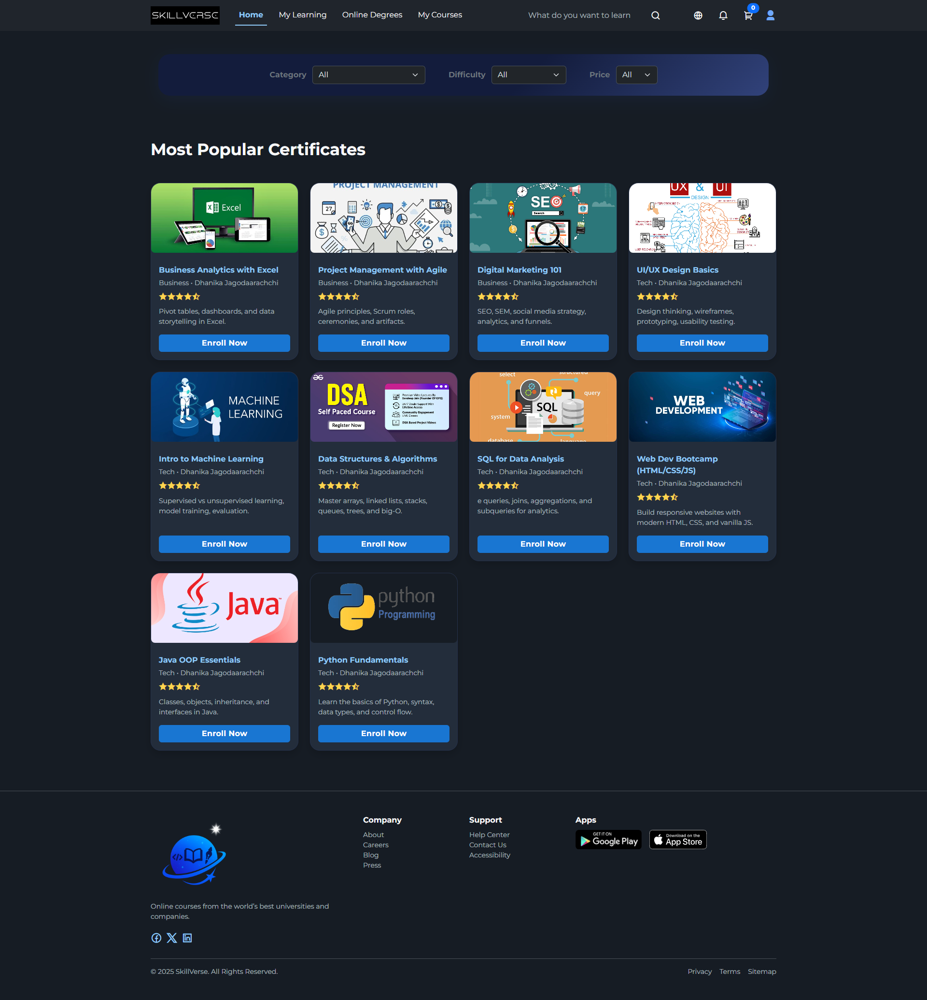
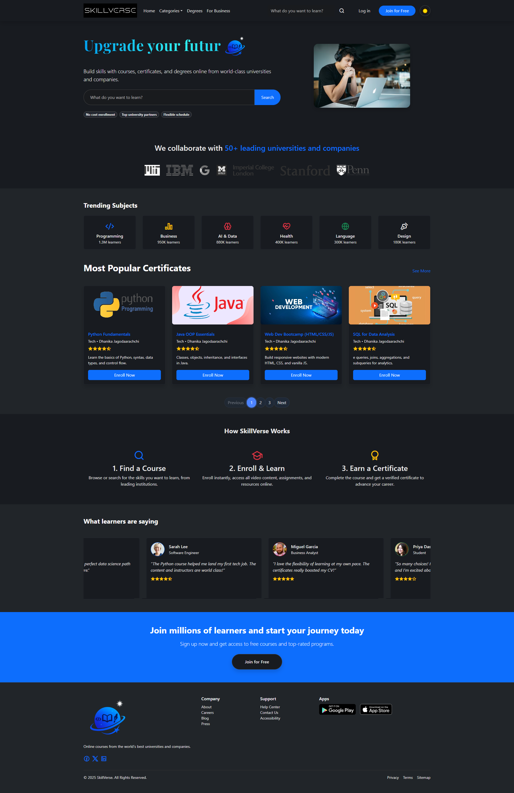
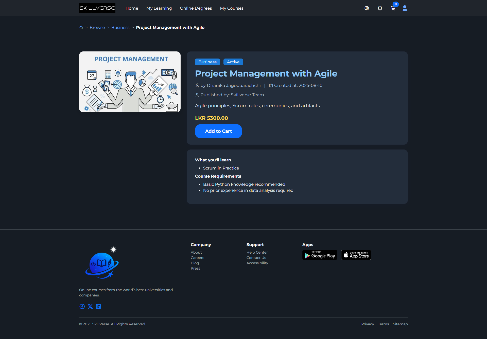
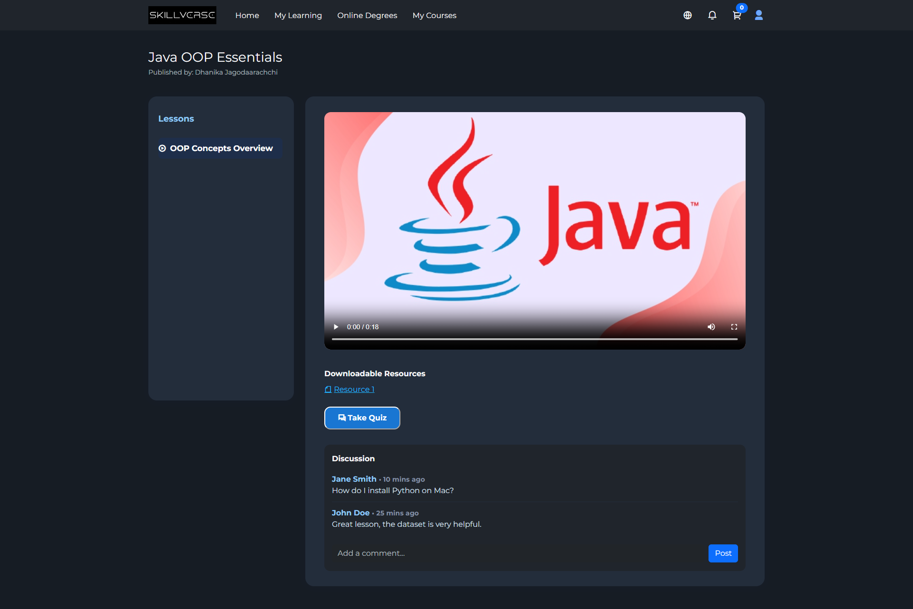
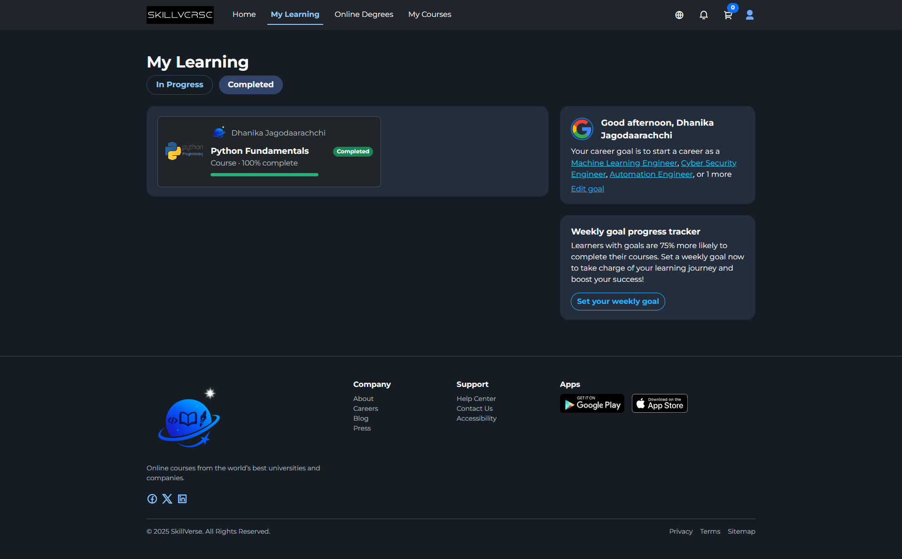
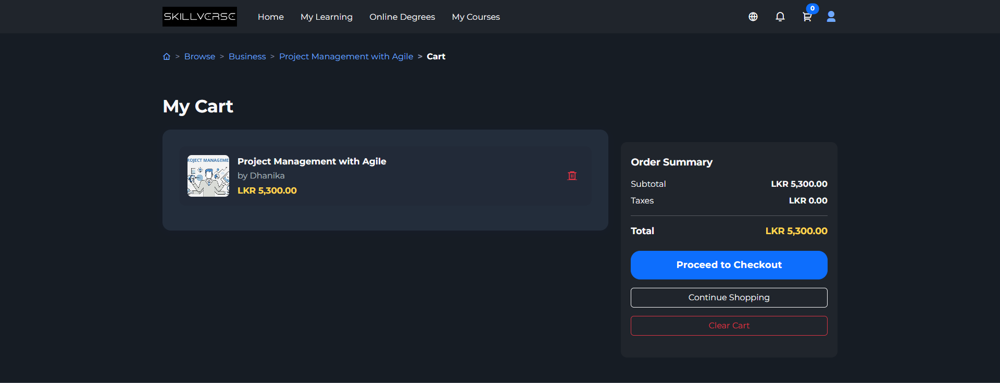
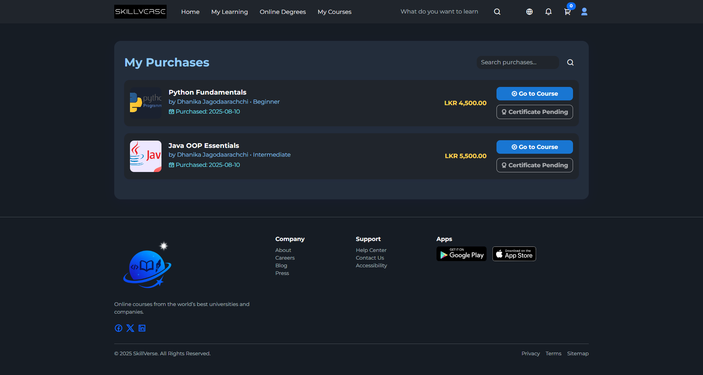
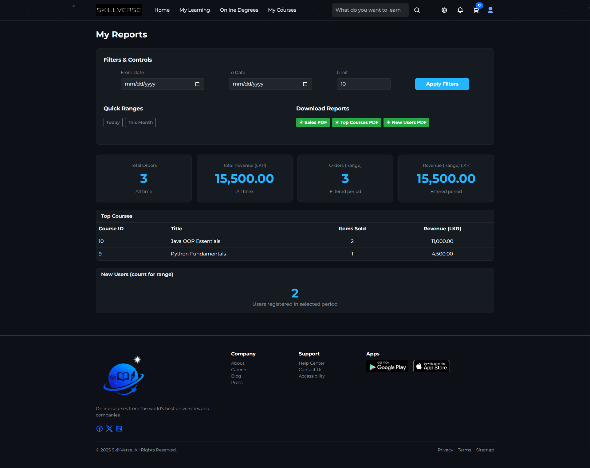

# SkillVerse

<p align="center">
  
</p>

**SkillVerse** is a web-based online learning platform that enables learners to discover, purchase, and complete courses while giving instructors and administrators tools to manage educational content and platform activity. It is built as a Java web application using Apache NetBeans, with a responsive HTML/CSS interface styled using Tailwind CSS.

## Table of Contents

- [Overview](#overview)
- [Features](#features)
- [Screenshots](#screenshots)
- [Technology Stack](#technology-stack)
- [Architecture](#architecture)
- [Project Structure](#project-structure)
- [Prerequisites](#prerequisites)
- [Installation](#installation)
- [Configuration](#configuration)
- [Running the Application](#running-the-application)
- [Building for Production](#building-for-production)
- [Usage](#usage)
- [Security Considerations](#security-considerations)
- [Roadmap](#roadmap)
- [Contributing](#contributing)
- [License](#license)
- [Author](#author)

## Overview

SkillVerse provides a complete learning-commerce workflow: users can browse public courses, view course details, add courses to a cart, complete checkout, access purchased learning material, and track their learning progress. The platform also includes instructor-facing pages and administrative reporting views.

The application follows a conventional Java web-application structure, separating server-side Java logic, web resources, configuration, and documentation assets. The front end uses HTML pages and Tailwind CSS, while the backend is implemented in Java and deployed through a servlet-compatible web container. [24][25][26]

## Features

### Learner Features

- Browse publicly available courses
- View detailed course information
- Add courses to a shopping cart
- Manage cart items before checkout
- Complete the checkout workflow
- Access purchased courses through **My Learning**
- View lesson content through the course lesson interface
- Track purchased courses and purchase history

### Instructor Features

- Instructor dashboard and course-management interface
- Course content organization
- Learning-material access through lesson pages

### Administrative Features

- Administrative reporting dashboard
- Platform activity and business reporting views
- Course and user-management support

## Screenshots

### Landing Page

The landing page introduces SkillVerse and provides entry points for discovering courses and platform features.



### Home Dashboard

The home dashboard presents accessible navigation for courses, learning activity, and account-related actions.


### Course Details

Learners can inspect individual course information before enrolling or purchasing.



### Lesson View

The lesson view provides access to course learning material.



### My Learning

The My Learning area allows learners to access and continue their enrolled courses.



### Shopping Cart

The cart allows learners to review selected courses before proceeding to checkout.



### Purchase History

The purchase history view provides a record of completed course transactions.



### Admin Reports

Administrative reports provide insight into platform activity and course performance.



## Technology Stack

| Layer | Technology |
|---|---|
| Backend | Java |
| Web framework | Java Servlet / JSP-based web application |
| Front end | HTML5, CSS3, JavaScript |
| Styling | Tailwind CSS |
| CSS tooling | PostCSS and Autoprefixer |
| Build tool | Apache Ant |
| IDE | Apache NetBeans |
| Application server | Apache Tomcat or another Jakarta/Java EE-compatible servlet container |
| Package management | npm |
| License | ISC |

The repository includes `build.xml`, `web/WEB-INF`, Java source under `src/java`, and Tailwind-related development dependencies in `package.json`. [23][24][25][26]

## Architecture

SkillVerse follows a layered Java web-application architecture:

```text
Browser / Client
      │
      ▼
HTML, CSS, JavaScript Front End
      │
      ▼
Java Servlet / Web Layer
      │
      ▼
Application Logic
      │
      ▼
Data / External Services
```

- **Presentation layer:** HTML pages, assets, and Tailwind-based styling.
- **Web layer:** Java classes and servlet configuration under `src/java` and `src/conf`.
- **Application layer:** Course, cart, checkout, learning, instructor, and reporting workflows.
- **Deployment layer:** NetBeans/Ant build output deployed to a servlet container.

## Project Structure

```text
SkillVerse/
├── src/
│   ├── conf/              # Application and server configuration
│   ├── java/              # Java backend source code
│   └── docs/              # README screenshots and documentation assets
│       ├── cart.png
│       ├── history.png
│       ├── home.png
│       ├── index.png
│       ├── lesson.png
│       ├── my-learning.png
│       ├── reports.png
│       └── single-product-view.png
├── web/
│   ├── WEB-INF/           # Web deployment configuration
│   ├── assets/            # Static assets
│   ├── index.html         # Landing page
│   ├── home.html          # Home dashboard
│   ├── course-view.html   # Course detail page
│   ├── lesson.html        # Lesson viewer
│   ├── cart.html          # Shopping cart
│   ├── checkout.html      # Checkout workflow
│   ├── my-learning.html   # Learner dashboard
│   ├── purchases.html     # Purchase history
│   ├── instructor.html    # Instructor interface
│   └── admin-reports.html # Administrative reports
├── build/                 # Compiled build output
├── dist/                  # Distributable build artifacts
├── lib/                   # Project dependencies
├── nbproject/             # NetBeans project metadata
├── node_modules/          # npm dependencies
├── build.xml              # Apache Ant build script
├── package.json           # npm project configuration
└── package-lock.json      # Locked npm dependency versions
```

## Prerequisites

Install the following before setting up the project:

- JDK 11 or later
- Apache NetBeans 12.0 or later
- Apache Tomcat 9+ or another compatible servlet container
- Apache Ant
- Node.js 18+ and npm

## Installation

Clone the repository:

```bash
git clone [https://github.com/DhanikaJ/SkillVerse.git](https://github.com/DhanikaJ/SkillVerse.git)
cd SkillVerse
```

Install front-end development dependencies:

```bash
npm install
```

Open the project in Apache NetBeans:

1. Launch Apache NetBeans.
2. Select **File → Open Project**.
3. Choose the cloned `SkillVerse` directory.
4. Allow NetBeans to resolve project dependencies and configuration.

## Configuration

Before deployment, configure environment-specific values such as database credentials, application URLs, payment-provider keys, and mail settings through secure configuration mechanisms.

Recommended practice:

- Do not commit secrets, API keys, passwords, or production database credentials.
- Use environment variables, a server-managed context configuration, or a secrets manager.
- Maintain separate configurations for development, staging, and production environments.
- Ensure the configured database schema and connection settings match the backend expectations.

## Running the Application

### Using Apache NetBeans

1. Open the project in NetBeans.
2. Select the configured Apache Tomcat server.
3. Right-click the project.
4. Choose **Clean and Build**.
5. Select **Run**.

### Using Apache Ant

Build and deploy the application using Ant:

```bash
ant clean
ant build
```

Deploy the generated artifact from the `dist/` directory to your servlet container.

## Building for Production

For a production deployment:

```bash
npm install
ant clean
ant build
```

Then deploy the resulting web application archive or build output to a hardened production servlet container.

Recommended production practices:

- Use HTTPS for all traffic.
- Run the application behind a reverse proxy such as Nginx or Apache HTTP Server.
- Enable structured logging and monitoring.
- Configure database connection pooling.
- Restrict administrative routes to authenticated administrator roles.
- Perform regular database backups.
- Remove development dependencies and unnecessary files from production deployments.

## Usage

1. Open the SkillVerse landing page.
2. Browse available courses or search for a specific topic.
3. Open a course to review its details.
4. Add the desired course to the cart.
5. Review the cart and proceed to checkout.
6. Complete the purchase process.
7. Open **My Learning** to access purchased courses.
8. Continue lessons and track learning progress.
9. Instructors and administrators can access their respective management and reporting views.

## Security Considerations

For production use, implement and verify the following:

- Authentication and authorization for learner, instructor, and administrator roles
- Secure session management and session timeout controls
- Input validation and output encoding to prevent XSS
- Parameterized database queries to prevent SQL injection
- CSRF protection for state-changing requests
- Secure payment integration and transaction verification
- HTTPS enforcement and secure HTTP headers
- Least-privilege database access
- Dependency vulnerability scanning

## Roadmap

Planned improvements include:

- REST API layer for mobile and third-party integrations
- Video streaming and lesson-progress tracking
- Quizzes, assignments, and certification generation
- Instructor analytics and revenue dashboards
- Reviews, ratings, and discussion forums
- Coupon codes, subscriptions, and installment payments
- Automated email notifications
- Search, recommendations, and personalized learning paths
- Automated test suite and CI/CD pipeline
- Docker-based deployment configuration

## Contributing

Contributions are welcome. Please follow these steps:

1. Fork the repository.
2. Create a feature branch:

   ```bash
   git checkout -b feature/your-feature-name
   ```

3. Make your changes and test them locally.
4. Commit with a clear message:

   ```bash
   git commit -m "feat: add course progress tracking"
   ```

5. Push the branch:

   ```bash
   git push origin feature/your-feature-name
   ```

6. Open a pull request describing the change, testing performed, and any related issues.

## License

This project is licensed under the ISC License. See the license field in [`package.json`](package.json) for details. [24]

## Author

**DhanikaJ**  
GitHub: [https://github.com/DhanikaJ](https://github.com/DhanikaJ)
